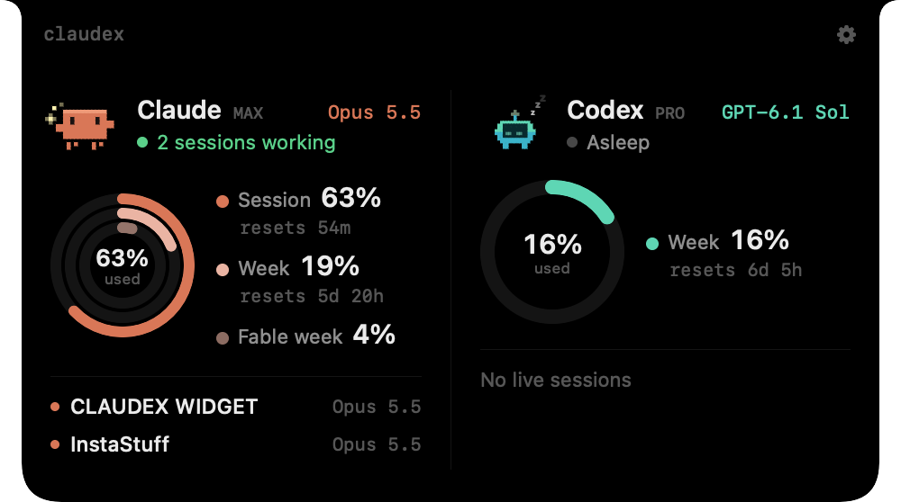
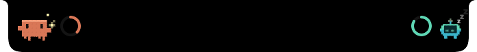

# Claudex

[](https://github.com/Wasif-Karim03/Claudex_Widget/actions/workflows/tests.yml)

A small macOS widget that lives under the camera notch and shows how much of your **Claude** and **Codex** usage limits you have used, with two animated pixel mascots.



Collapsed, it blends into the notch with a mascot and a ring on each side of the camera:



Hover over it to open the card. For each tool it shows:

- **Usage rings**, one per limit, filled by % used. Claude shows the session (5-hour) window, the weekly window, and any per-model weekly limit such as *Fable week*. Codex shows whatever windows the CLI reports. The numbers match Claude Code's `/usage`.
- **When each limit resets**
- **Your plan** (e.g. Max, Pro) and the **model** of your most recent session
- **Live sessions**: every session written to in the last two minutes, with its project and model. Claude Code subagents are shown indented under the sessions.

Rings turn red above 80% used.

### The mascots

Claude is a blocky orange critter and Codex a teal robot. They react to what you're doing:

- **Working** (a session is writing): they bounce and throw little typing sparkles
- **Idle**: slow breathing and the occasional blink
- **Asleep** (nothing for over 10 minutes): eyes closed, floating z's
- **Worried** (a limit over 80% used): a nervous wiggle

With *Reduce Motion* on, they hold still.

## Requirements

- An Apple silicon Mac running macOS 14 or later. It works best on a MacBook with a notch; on other displays it sits at the top centre of the screen.
- Xcode 16 or later, or another Swift 6 toolchain, to build it
- [Claude Code](https://claude.com/claude-code) installed and signed in. Claudex reads Claude Code's login from your keychain to fetch usage.
- For Codex: the [Codex CLI](https://github.com/openai/codex), used at least once

You can use just one of the two. The other side shows that it has nothing to report.

## Install

```sh
git clone https://github.com/Wasif-Karim03/Claudex_Widget.git
cd Claudex_Widget
./scripts/install.sh
```

The script builds a release version, copies `Claudex.app` to `/Applications` and opens it. The first time it runs from there, it adds itself to **Login Items**, so it starts with your Mac. To turn that off, use **Launch at Login** in the gear menu or System Settings › General › Login Items. Once you turn it off, it stays off.

Claudex reads the token with macOS's built-in `security` tool, so the first time it may show a keychain prompt asking to let `security` access *Claude Code-credentials*. Choose **Always Allow**.

To update, pull and run `./scripts/install.sh` again. To uninstall, quit Claudex from the gear menu, remove it from Login Items and delete `/Applications/Claudex.app`.

The gear menu, or a right-click on the widget, has **Refresh**, **Launch at Login** and **Quit**.

## Where the data comes from

| | Source |
| --- | --- |
| Claude usage | `GET https://api.anthropic.com/api/oauth/usage` with Claude Code's sign-in token |
| Claude plan | Claude Code's keychain entry |
| Claude sessions and models | Claude Code's transcripts in `~/.claude/projects/` (including subagent logs) |
| Codex usage, plan, sessions and models | Codex's session logs in `~/.codex/sessions/` |

The Claude usage endpoint is the one Claude Code itself uses. It is not a documented public API, so it may change without notice.

## Privacy

- The Claude sign-in token is read from the keychain fresh for each request. It is sent only to `api.anthropic.com`, and is never stored, cached, logged or written to disk.
- Claudex never refreshes the token. If it has expired, the card asks you to sign in to Claude Code; using Claude Code once fixes it.
- Session logs are only read, never written. Only the last 64 KB of each live log is read.
- Nothing else leaves your Mac. There are no analytics.
- Claudex never lists privacy-protected folders such as Desktop, Documents or Downloads, so it won't trigger macOS folder-access prompts.

## How often it updates

- **Claude usage**: once a minute. On errors or rate limiting it backs off, up to 15 minutes, and honours `Retry-After`.
- **Session logs**: checked every 3 seconds by modification date. A log is parsed only when it has changed.
- If an update fails, the last numbers stay on screen, dimmed and marked with how old they are.

## Development

```sh
swift build
swift test                                    # core logic: parsing, usage client, formatting
./scripts/bundle.sh && open build/Claudex.app # run a local build without installing
```

The code is split into two parts:

- `ClaudexCore` holds the models, log parsing and usage client. It uses only Foundation and has the tests.
- `Claudex` is the app: an AppKit panel with SwiftUI views.

To render the widget to a PNG without screen-recording permission (this is how the screenshots above were made):

```sh
CLAUDEX_PIN_EXPANDED=1 CLAUDEX_SNAPSHOT=card.png .build/debug/Claudex
CLAUDEX_PIN_EXPANDED=1 CLAUDEX_SNAPSHOT_STATE=collapsed CLAUDEX_SNAPSHOT=pill.png .build/debug/Claudex
```

Issues and pull requests are welcome.

## Disclaimer

Claudex is an independent project. It is not affiliated with or endorsed by Anthropic or OpenAI. Claude is a trademark of Anthropic; Codex is a trademark of OpenAI.

## License

[MIT](LICENSE)
